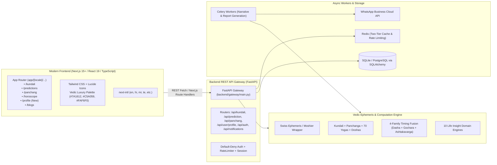

# AstroLogic AI — Master Project Context, Architecture & Developer Instructions

> **MANDATORY INSTRUCTIONS FOR ALL AGENTS & DEVELOPERS:**
> 1. **Modern Frontend ONLY**: The legacy HTML/Jinja2 templates (`app/templates/`, `frontend-legacy/`) are deprecated and **NOT** in use. All frontend engineering, UI components, pages, and client state **MUST** be implemented exclusively in the **Next.js application located at `frontend/`**.
> 2. **Backend API Role**: The FastAPI backend (`backend/`) serves strictly as a headless REST API Gateway exposing endpoints under `/api/...`.
> 3. **Calculation Integrity**: The backend calculation engines (Swiss Ephemeris / Moshier, Surya Siddhanta combustion, Shadbala, Ashtakavarga, Timing Fusion, 10-domain evaluators) must remain mathematically deterministic with 0 unverified modifications.
> 4. **CONTINUOUS TECHNICAL MANUAL DOCUMENTATION (MANDATORY FOR EACH CHAT)**:
>    - For **every single chat, milestone, and architectural change**, you **MUST** update and expand the canonical engineering manual in `docs/manual/` (and its corresponding artifact).
>    - The documentation must not be superficial summaries. It must possess **rigorous technical and mathematical depth**:
>      * Core algorithms, mathematical formulas, and cryptographic proofs (e.g. SHA-256 Merkle–Damgård round functions, HMAC length-extension vulnerability & nested pad math, CSPRNG vs. linear PRNG entropy, constant-time timing-attack defense, Token Bucket rate-limiting differential equations).
>      * Architectural Decision Records (ADRs) with trade-off matrices (Option A vs Option B vs Option C).
>      * Step-by-step educational explanations so the user can learn from first principles as the system is built.
>      * Wire contracts, database B-Tree index mechanics, failure modes, and security attack vectors.
> 5. **Client Intelligence & Telemetry**: Maintain the 42-parameter client fingerprinting and device telemetry specification for automatic Vedic coordinate resolution, ghost session recovery, and anti-fraud defense.

---

## 1. System Architecture

---

## 2. Codebase Directory Map

| Directory | Purpose | Tech Stack / Rules |
| :--- | :--- | :--- |
| `frontend/` | **ACTIVE FRONTEND APPLICATION** | Next.js App Router, React, TypeScript, Tailwind CSS, `next-intl`. **All UI is built here.** |
| `frontend/app/[locale]/` | Localized Pages | Multilingual pages (`/kundali`, `/panchang`, `/profile`, `/predictions`). |
| `frontend/components/` | Reusable React Components | Vedic luxury styling (`#7A1612` Deep Crimson, `#C5A059` Gold, `#FAF6F0` Cream). |
| `backend/` | **ACTIVE BACKEND API** | Python 3.11, FastAPI, Uvicorn, SQLAlchemy, Alembic, Pydantic v2. |
| `backend/gateway/` | Gateway & Route Wiring | Central entry point (`main.py`) registering all service routers. |
| `backend/modules/` | Service Modules | `auth`, `kundali`, `panchang`, `prediction`, `horoscope`, `blog`, `feedback`. |
| `backend/shared/` | Shared Libraries | `ephemeris`, `veda` (classical Shastric rules, combustion, yogas), `cache`, `db`. |
| `app/templates/` | **DEPRECATED / DO NOT USE** | Legacy Jinja2 HTML templates. Superseded by `frontend/`. |
| `frontend-legacy/` | **DEPRECATED / ARCHIVED** | Old static assets. |

---

## 3. Product & Business Strategy

### A. 3 Core Revenue Streams
1. **B2C Digital Dossiers & Subscriptions**:
   - Free Tier: Daily Panchanga, basic D1 chart, today's planetary transit.
   - Pay-per-Report ($5–$15 / ₹299–₹999): High-converting 15-page PDF Dossiers (Career & Wealth Timing Blueprint, Kundali Compatibility Audit).
   - AstroLogic Pro Subscription ($9.99/mo / ₹499/mo): Continuous transit alerts, custom muhurta planner, unlimited AI queries.
2. **B2B Astrology-as-a-Service API**:
   - Metered API access ($0.02–$0.05/call) for matrimonial portals, dating apps, and lifestyle platforms.
3. **Astrologer Studio / Copilot**:
   - Professional SaaS ($29–$99/mo) for consulting astrologers with client CRM and branded PDF exports.

### B. Daily Personalized WhatsApp Messaging
- 98% open-rate delivery channel.
- Delivered at 7:00 AM user local time.
- Personalized based on **Natal Moon Sign**, **Janma Nakshatra (Tara Bala)**, **Active Dasha**, and **City-specific Rahu Kaal & Abhijit Muhurta**.
- Interactive two-way bot: users reply `1` for today's auspicious times, `2` for Dasha breakdown, or text questions to the AI Copilot.

---

## 4. Active Milestone: User Profile Section Implementation

### Requirements for the User Profile System:
1. **Cosmic Identity & Birth Details**:
   - Exact Birth Date, Time & City.
   - Automatically computed **Cosmic Badges**: Lagna (Ascendant), Moon Sign (Rashi), Janma Nakshatra, and current active Mahadasha / Antardasha.
   - Birth time uncertainty selector: `Exact (±1 min)`, `Approximate (±15 min)`, `Uncertain (±1 hr)`.
2. **Multi-Chart Family & Client Vault (`user_saved_charts`)**:
   - Ability to add, view, edit, and switch between saved profiles (`Self`, `Spouse`, `Children`, `Parents`, `Clients`).
   - 1-click actions: *"Open in Kundali"*, *"View 10-Domain Predictions"*, *"Check Compatibility"*.
3. **WhatsApp Daily Guidance Settings**:
   - WhatsApp Phone Number (with Country Code selector).
   - Toggle: `Enable Daily Morning Forecast on WhatsApp (7:00 AM)`.
   - Preferred language and city for localized Rahu Kaal.
4. **Account & Security Settings**:
   - Email, name, password change, subscription badge (`Free Trial` / `Pro Subscriber`).

### Technical Implementation Steps:
- **Backend API**:
  - `GET /api/user/profile` (returns profile + auto-computed cosmic badges).
  - `POST /api/user/profile` (updates birth info & recalculates badges).
  - `GET /api/user/charts` & `POST /api/user/charts` & `DELETE /api/user/charts/{id}` (manages family vault).
  - `POST /api/user/whatsapp-settings` (saves phone & WhatsApp delivery preferences).
- **Next.js Frontend**:
  - Create route at `frontend/app/[locale]/profile/page.tsx`.
  - Build modern tabbed profile component (`frontend/components/profile/ProfileView.tsx`).
  - Add `/profile` link into `frontend/components/Navbar.tsx`.
  - Add translation keys in `frontend/messages/{en,hi,mr}.json`.

---

## 5. Coding & Architecture Guardrails

1. **Always use the Next.js Frontend**: Do NOT write inline HTML or Jinja2 templates in `backend/app/templates/`.
2. **Strict TypeScript & Tailwind CSS**: Build responsive, accessible, mobile-friendly components adhering to the Vedic luxury theme (`#7A1612`, `#C5A059`, `#FAF6F0`).
3. **API Contracts**: All client-server communication must go through standard REST JSON payloads with clear HTTP status codes (`200`, `201`, `400`, `401`, `404`, `500`).
4. **Ephemeris & Shastric Precision**: Never approximate or hallucinate planetary coordinates. Always invoke the verified ephemeris and Veda calculation modules.

