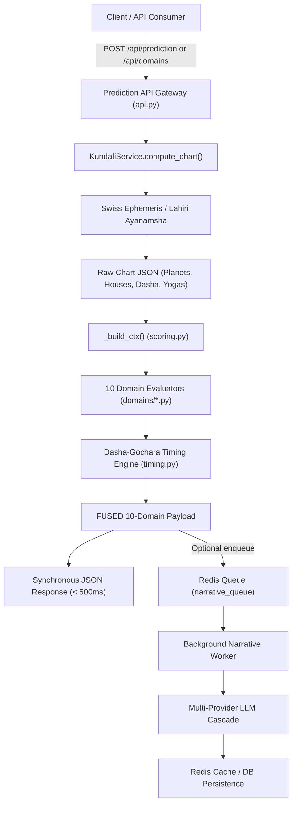

# AstroLogic AI — Domain Predictions Architecture & Engine Specification

**Document Version:** 2.1.0  
**Status:** Active Production Architecture  
**Author:** Senior Python/FastAPI Architect & Vedic Astrology Calculation Specialist  
**Target Repository:** `astro-platform/backend/modules/prediction/`

---

## 1. Executive Summary & Core Architecture

AstroLogic AI evaluates life predictions through a **modular, mathematically deterministic Vedic Astrology Engine** layered beneath an asynchronous AI narrative synthesis service.

Rather than delegating astrological judgment to an unpredictable Large Language Model, the system executes **two strictly decoupled phases**:
1. **Deterministic Core Calculation:** Swiss Ephemeris (`pyswisseph`) calculates planetary coordinates with sub-arcsecond accuracy, maps them to the Lahiri Sidereal Zodiac (Chitrapaksha Ayanamsha), builds whole-sign houses, evaluates planetary dignities, doshas, and yogas, and passes this context into 10 domain evaluators.
2. **Generative Interpretation (Optional / Async):** The structured mathematical findings (scores, timing windows, partner traits, career sectors) are formatted into an interpretive prompt and passed to an enterprise AI cascade (Groq / OpenAI / Gemini / local Ollama) or a rule-based synthesis engine.

---

## 2. End-to-End Prediction Pipeline

---

## 3. The Context Builder (`_build_ctx` in `scoring.py`)

All 10 domain evaluators receive a single immutable dictionary (`ctx`) constructed by `_build_ctx()` in `modules/prediction/scoring.py`.

### 3.1 Input Mapping
`_build_ctx` takes the raw Kundali dictionary (containing planetary degrees, signs, houses, Lagna, current Mahadasha, and current Antardasha) and produces:
- `lagna`: Sidereal Ascendant sign (e.g., `"Mesha"`).
- `lagna_idx`: 0-indexed integer (0 for Mesha to 11 for Meena).
- `planet_map`: Structured map containing degree, retrograde status, nakshatra, house, and dignity scores.
- `house_lords`: Map of `{house_number: planet_name}` based on sign ownership.
- `house_signs`: Map of `{house_number: sign_name}`.
- `mahadasha` & `antardasha`: Active Vimshottari lords.
- `transit_map`: Real-time planetary positions computed via `swe.calc_ut` for the current UTC date.
- `yogas` & `doshas`: Lists of active yogas (Raj Yoga, Dhana Yoga) and afflictions (Mangal Dosha, Kaal Sarp).

### 3.2 Positional Strength Function (`_planet_strength`)
Planetary dignity is mapped into integer scores:
| State | Classical Sanskrit Term | Points |
| :--- | :--- | :---: |
| **Exalted** | *Ucha* | `+3` |
| **Own Sign** | *Swakshetra* | `+2` |
| **Neutral / Friendly** | *Mitra / Sama* | `0` |
| **Debilitated** | *Neecha* | `-2` |

---

## 4. Generic Scoring Rules & Percentage Normalization

Every life domain computes a normalized score between **15% and 95%** using the mathematical foundation in `scoring.py`:

$$\text{Raw Score} = \text{House Occupants Score} + \text{House Lords Score} + \text{Karaka Score}$$

$$\text{Final Percentage} = \text{clamp}(50 + (\text{Raw Score} \times 6) + \text{Dasha Bonus}, 15, 95)$$

### Key Scoring Utilities
1. `_score_planets_in_houses(ctx, key_houses)`:
   - Assigns benefic weights: **Jupiter (+3)**, **Venus (+2)**, **Moon (+1)**, **Mercury (+1)**.
   - Assigns malefic weights: **Sun (0)**, **Mars (-1)**, **Saturn (-2)**, **Rahu (-1)**, **Ketu (-1)**.
   - **House Amplifiers:** Kendra houses (1, 4, 7, 10) amplify the planet's impact by **1.4x**; Trikona houses (5, 9) amplify by **1.1x**; Dusthana/Upachaya by **0.9x**.
2. `_score_house_lord(ctx, house)`:
   - Evaluates the lord's dignity score (`-2` to `+3`).
   - Adds `+1` if placed in auspicious houses (1, 2, 4, 5, 7, 9, 10, 11) or `-1` if in Dusthanas (6, 8, 12).
3. `_dasha_activates(ctx, houses)`:
   - Checks if the current Mahadasha or Antardasha lord occupies or rules any of the domain's key houses. If active, grants a **+8 to +12 point bonus** to the final score.

---

## 5. Domain-by-Domain Prediction Logic

AstroLogic AI evaluates 10 discrete life domains in `modules/prediction/domains/`:

### 1. Marriage & Relationships (`domains/marriage.py`)
- **Key Houses:** 7 (Spouse/Marriage), 5 (Romance), 2 (Family expansion), 8 (Intimacy/Longevity).
- **Primary Karaka:** Venus (*Shukra*); Secondary Karaka: Jupiter (*Guru*).
- **Marriage Type Classifier:**
  - *Venus in 5th:* Love marriage (strong romance).
  - *Jupiter in 7th:* Traditional / Arranged marriage.
  - *Rahu in 7th:* Unconventional, foreign, or inter-cultural marriage.
  - *Venus in 7th:* Love or love-cum-arranged marriage.
- **Partner Archetype:** Derived from the 7th sign (Aries = ambitious/dynamic; Taurus = loyal/sensual; Gemini = communicative; Cancer = emotional/nurturing; etc.) combined with planetary modifiers of any planets occupying the 7th.
- **Mangal Dosha:** Evaluated via Mars in houses 1, 4, 7, 8, 12.
- **Intimacy:** Mars or Venus in 8th indicates intense physical chemistry; Jupiter/Moon indicates emotional-spiritual connection.

### 2. Career & Profession (`domains/career.py`)
- **Key Houses:** 10 (Karma/Status), 6 (Service/Effort), 11 (Income/Gains).
- **Primary Karaka:** Sun (*Surya* — Authority); Secondary: Saturn (*Shani* — Labor/Service), Mercury (*Budha* — Trade/IT).
- **Sector Classifier:**
  - *Sun strong in 10th:* Government, IAS, Politics, Executive leadership.
  - *Saturn in 10/6/11:* Corporate, Heavy industry, Engineering, Public service.
  - *Mercury in 10/6:* Business, Finance, Software/IT, Media.
  - *Jupiter in 10/9:* Law, Higher Education, Advisory, Banking.
  - *Mars in 10/6:* Defense, Police, Surgery, Sports, Civil Engineering.
- **Business vs. Job:** Mercury in 10th favors entrepreneurship; Saturn in 10th favors salaried corporate employment.
- **Foreign Career:** Rahu occupying or transiting the 10th house indicates global or multinational engagements.

### 3. Wealth & Finance (`domains/wealth.py`)
- **Key Houses:** 2 (Accumulated wealth/Dhana), 11 (Gains/Income), 9 (Fortune/Bhagya), 5 (Speculation).
- **Primary Karaka:** Jupiter (*Guru*); Secondary: Venus (*Shukra*), Moon (*Chandra*).
- **Dhana Yogas:** Checks presence of classical wealth yogas (Lakshmi Yoga, Kubera Yoga, 2nd-11th lord mutual aspect).
- **Income Sources:** Evaluated via the sign on the 11th house cusp.
- **Sudden Gains:** Rahu or Jupiter in the 8th house indicates inheritance, stock windfalls, or sudden windfalls.
- **Debt Risk:** Saturn in the 6th house indicates prudent budgeting and debt repayment capacity.

### 4. Health & Longevity (`domains/health.py`)
- **Key Houses:** 1 (Constitution/Vitality), 6 (Disease/Roga), 8 (Longevity/Crises), 12 (Hospitalization).
- **Primary Karaka:** Sun (Vitality); Secondary: Saturn (Chronic illness), Moon (Mental health).
- **Ayurvedic Tridosha Mapping:** Derived from Lagna sign:
  - *Vata:* Mithuna, Kanya, Tula, Makara, Kumbha.
  - *Pitta:* Mesha, Simha, Vrischika, Dhanu.
  - *Kapha:* Vrishabha, Karka, Meena.
- **Vulnerable Anatomical Organs:** Derived from the sign occupying the 6th house cusp (e.g., Mesha = head/brain; Kanya = intestines/digestion; Vrischika = reproductive system).
- **Mental Health:** Afflictions to Moon in Dusthanas (6, 8, 12) identify high emotional sensitivity.

### 5. Education & Skills (`domains/education.py`)
- **Key Houses:** 4 (Foundational education), 5 (Intellect/Memory), 9 (Higher learning/Research).
- **Primary Karaka:** Mercury (Cognition/Logic), Jupiter (Wisdom/Philosophy).
- **Study Fields:** Derived from the sign on the 4th cusp.
- **Competitive Exams:** Scores exceeding 65% indicate strong competitive examination capability.
- **Foreign Education:** Rahu in 4th, 5th, or 9th house indicates studying abroad.

### 6. Children & Next Generation (`domains/children.py`)
- **Key Houses:** 5 (Putra Bhava), 9 (Grandchildren/Dharma).
- **Primary Karaka:** Jupiter (*Putra Karaka*).
- **Progeny Promise:** Evaluates Jupiter's strength and 5th lord dignity. Identifies Santana Yoga or Putra Dosha.
- **Child Personality:** Derived from planets occupying the 5th house (e.g., Jupiter/Mercury = highly creative and academic; Mars = high physical energy).

### 7. Property, Vehicles & Real Estate (`domains/property.py`)
- **Key Houses:** 4 (Matru/Griha Bhava), 2 (Assets), 12 (Investments).
- **Primary Karaka:** Mars (*Bhumi Karaka* — Land/Real Estate); Venus (*Vahana Karaka* — Luxury vehicles).
- **Architecture & Home Type:** Derived from the sign on the 4th cusp (e.g., Taurus = garden/luxury; Gemini = urban multi-story; Cancer = water body proximity).
- **Multiple Properties:** High Mars strength ($\ge +2$) or Mars in the 4th house.

### 8. Foreign Travel & Relocation (`domains/travel.py`)
- **Key Houses:** 12 (Foreign lands/Relocation), 9 (Long-distance travel), 3 (Short journeys).
- **Primary Karaka:** Rahu (Alien environments/Foreigners), Moon (Movement/Tides).
- **Permanent Settlement:** Rahu in 12, 9, 7, or 1 indicates long-term foreign residence.
- **Auspicious Direction:** Mapped from the 4th house sign (Aries = East, Taurus = South, Gemini = North, Cancer = Northwest, etc.).

### 9. Spirituality & Karma (`domains/spirituality.py`)
- **Key Houses:** 9 (Dharma/Guru), 12 (Moksha/Liberation), 5 (Purva Punya), 8 (Occult/Mysticism).
- **Primary Karaka:** Ketu (*Moksha Karaka*), Jupiter (*Dharma Karaka*).
- **Ishta Devata / Ruling Deity:** Computed from the Moon's natal Nakshatra (e.g., Rohini = Krishna, Ardra = Shiva, Shravana = Vishnu, Mula = Kali).
- **Past Life Karma:** Inferred from the house placement of Ketu.

### 10. Challenges & Doshas (`domains/challenges.py`)
- **Doshas Detected:**
  - *Kaal Sarp Dosh:* All 7 physical planets hemmed between Rahu and Ketu.
  - *Mangal Dosh:* Mars in houses 1, 4, 7, 8, or 12.
  - *Shani Sade Sati:* Transiting Saturn within $\pm 1$ sign of the natal Moon sign.
  - *Pitru Dosh:* Afflictions to Sun/9th lord by Rahu/Ketu/Saturn.
  - *Grahan Dosh:* Sun or Moon conjunct Rahu or Ketu.
- **Legal Risk:** Malefics occupying the 6th house.

---

## 6. Event Timing Engine: Dasha-Gochara Window Fusion

The timing engine (`timing_fusion.py`) orchestrates 15-year forward event windows using a **60% Dasha + 40% Transit Fusion Model**:

$$\text{Fused Score}(t) = (0.60 \times \text{Dasha Score}(t)) + (0.40 \times \text{Transit Score}(t))$$

### 6.1 Dasha Activation (60% Weight)
- Evaluates Vimshottari Mahadasha, Antardasha, and Pratyantardasha (MD/AD/PD).
- Scores whether the active period lords rule or occupy significator houses, act as natural karakas, or possess functional benefic status for the native's Lagna.

### 6.2 Gochara Transit Activation (40% Weight)
- Computes monthly planetary ephemerides for Jupiter, Saturn, Rahu, and Ketu.
- Applies the classical **Double Transit Rule**:
  - Jupiter's aspect or transit over the domain house (expansion/blessing).
  - Saturn's aspect or transit over the domain house (karmic manifestation/structure).
- Evaluates Sade Sati suppression factors for health and mental peace.

### 6.3 Window Ranking & Confidence Tiers
Scores are aggregated into continuous candidate windows and assigned confidence tiers:
- **High ($\ge 0.75$):** Simultaneous alignment of primary Dasha and favorable Jupiter double-transit.
- **Moderate ($\ge 0.55$):** Strong Dasha with neutral transit, or vice versa.
- **Possible ($\ge 0.35$):** Secondary sub-period activation.

---

## 7. Remedial Recommendation Engine (`remedies.py`)

When the engine detects an afflicted house, lord, or karaka (negative score, debilitation, or dosha), `_build_remedies()` constructs personalized countermeasures across four classical categories:

1. **Ratna (Gemstones):** Recommends functional benefic gemstones (e.g., Blue Sapphire for Saturn only when Saturn is a Yogakaraka for Taurus/Libra Lagna).
2. **Mantra (Japa):** Specific planetary Vedic and Beej mantras with count instructions (e.g., 108 repetitions on designated weekdays).
3. **Daana (Charity):** Specific items, colors, and recipients for planetary pacification (e.g., black sesame seeds on Saturday for Saturn; green pulses on Wednesday for Mercury).
4. **Vrata (Fasting):** Recommended days of contemplation and fasting to balance specific elemental doshas.

---

## 8. Summary of API Contracts

| Route | Method | Purpose | Latency Target |
| :--- | :---: | :--- | :---: |
| `/api/prediction` | `POST` | Calculates domain scores immediately and enqueues async AI narrative job. | `< 500ms` |
| `/api/domains` | `POST` | Returns deep calculations, partner traits, career sectors, and timing windows across all 10 domains. | `< 350ms` |
| `/api/prediction/timing/{domain}` | `POST` | Returns standalone 15-year Dasha + Gochara timing windows for a specific domain. | `< 250ms` |
| `/api/narrative/{job_id}` | `GET` | Polls background worker status for generated AI synthesis. | `< 50ms` |
