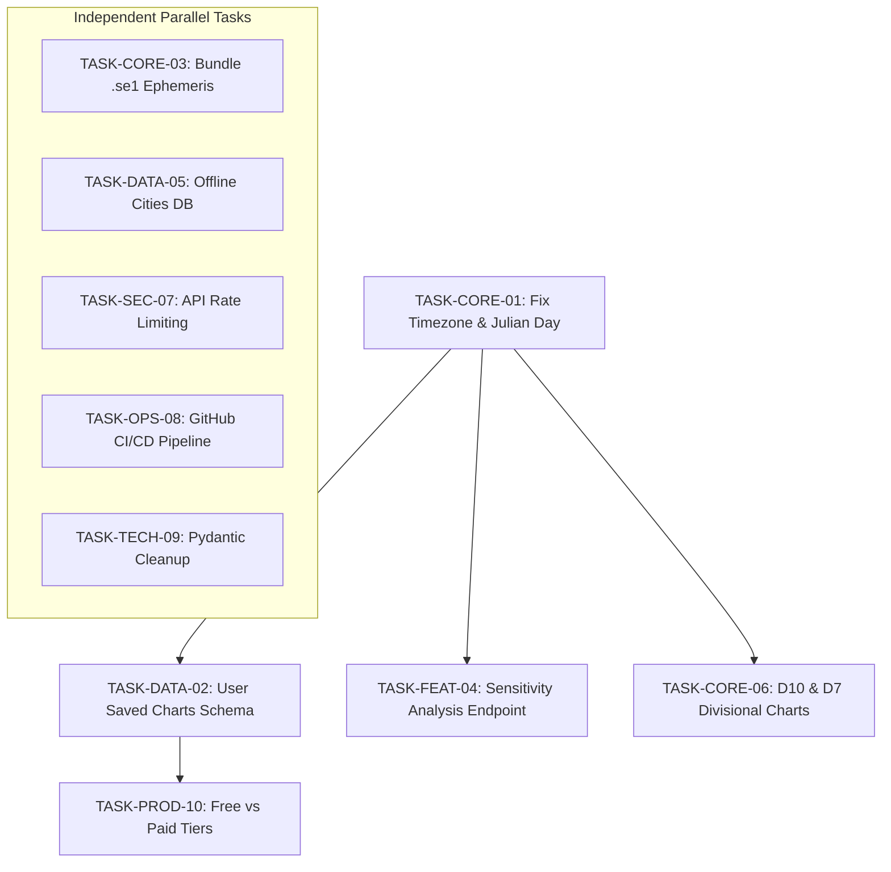

# Next Phase Implementation Roadmap

**Project:** AstroLogic AI  
**Recommended Next Phase:** **Phase 5 Stabilization & Hardening (Phase 5.2) + User Data Foundations (Phase 1.2)**  
**Objective:** Resolve critical timezone/Julian Day defects, implement user chart persistence, and package production ephemeris before initiating commercial launch (Phase 6).

---

## 1. Strategic Context & Phase Assessment

1. **Current Overall Phase:**  
   **Phase 3 (Astrology Product Modules) Complete / Phase 5 (Quality & Testing) Foundation Established.**  
   All core astrological calculation features, prediction domains, timing engines, and test suites are operational and pass 174 automated tests.
2. **Most Advanced Verified Phase:**  
   **Phase 5 (Testing & Quality Foundation):** 174 unit, integration, benchmark, and reference regression tests pass in 71 seconds with zero failures.
3. **Phase with Largest Remaining Gap:**  
   **Phase 1 (User Data Persistence) & Phase 6 (Commercial Launch):** Users cannot save multiple charts, and zero payment/monetization infrastructure exists.
4. **Is the Project Ready to Move Forward to Commercial Launch (Phase 6)?**  
   **NO — BLOCKED.** Advancing to commercial launch without fixing the hardcoded IST timezone in `engine.py` will produce erroneous astrological readings for international paying users. Advancing without chart persistence means users cannot save charts.

---

## 2. Critical Blockers to Resolve

1. **Blocker 1 (Accuracy):** Hardcoded `ist_offset = 5.5` in [`backend/modules/kundali/engine.py:102`](file:///c:/Desktop/astro_may_res%20(2)/astro-platform/backend/modules/kundali/engine.py#L102).
2. **Blocker 2 (Accuracy):** Month-underflow date wrapping defect in Julian Day calculation ([`backend/modules/kundali/engine.py:105-109`](file:///c:/Desktop/astro_may_res%20(2)/astro-platform/backend/modules/kundali/engine.py#L105-L109)).
3. **Blocker 3 (Utility):** Timezone utility functions ignoring `tz_name` arguments ([`backend/shared/timezone/tz.py:58-63`](file:///c:/Desktop/astro_may_res%20(2)/astro-platform/backend/shared/timezone/tz.py#L58-L63)).
4. **Blocker 4 (Persistence):** Absence of `charts` and `saved_kundalis` relational database tables in Alembic migrations.
5. **Blocker 5 (Precision):** Absence of `.se1` Swiss Ephemeris data files forcing fallback to Moshier analytical mode.

---

## 3. Top 10 Prioritized Implementation Tasks

### Task 1: Eliminate Hardcoded Timezone & Fix Julian Day Date-Wrapping
- **Task ID:** `TASK-CORE-01`
- **Objective:** Parameterize `calculate_kundali` to accept IANA timezone string; replace manual day subtraction with Python `datetime.astimezone(timezone.utc)`.
- **Reason:** Resolves critical calculation error for all non-IST births and prevents month-underflow crashes on the 1st of each month.
- **Files / Modules:** [`backend/modules/kundali/engine.py`](file:///c:/Desktop/astro_may_res%20(2)/astro-platform/backend/modules/kundali/engine.py), [`backend/modules/kundali/api.py`](file:///c:/Desktop/astro_may_res%20(2)/astro-platform/backend/modules/kundali/api.py), [`backend/shared/timezone/tz.py`](file:///c:/Desktop/astro_may_res%20(2)/astro-platform/backend/shared/timezone/tz.py).
- **Dependencies:** None.
- **Estimated Complexity:** **Small** (1–2 days).
- **Test Requirements:** Unit tests for births on month transitions (e.g., `2026-01-01 01:00 AM IST`) and international locations (New York, London, Tokyo).
- **Definition of Done:** `calculate_kundali` accepts `tz_name="Asia/Kolkata"` default; zero occurrences of hardcoded `5.5` in calculation files; all 174 existing tests plus new timezone tests pass.

---

### Task 2: Implement User Saved Charts Database Schema & CRUD API
- **Task ID:** `TASK-DATA-02`
- **Objective:** Create `charts` table in Alembic migrations and expose `/api/user/charts` endpoints for creating, listing, viewing, and deleting saved charts.
- **Reason:** Transforms platform from an ephemeral single-session calculator into a user-retaining web application.
- **Files / Modules:** [`backend/alembic/versions/`](file:///c:/Desktop/astro_may_res%20(2)/astro-platform/backend/alembic/versions/), [`backend/modules/kundali/models.py`](file:///c:/Desktop/astro_may_res%20(2)/astro-platform/backend/modules/kundali/), [`backend/modules/kundali/api.py`](file:///c:/Desktop/astro_may_res%20(2)/astro-platform/backend/modules/kundali/api.py).
- **Dependencies:** `TASK-CORE-01`.
- **Estimated Complexity:** **Medium** (2–3 days).
- **Test Requirements:** Integration tests for authenticated chart creation, retrieval, and authorization isolation between users.
- **Definition of Done:** User can persist a birth chart, retrieve a list of saved charts in UI, and reload full Kundali and prediction views from database ID.

---

### Task 3: Bundle Swiss Ephemeris (`.se1`) Files & Validate High Precision
- **Task ID:** `TASK-CORE-03`
- **Objective:** Package Astrodienst `.se1` ephemeris files (Sun, Moon, Planets for 1800–2100 CE) into `backend/ephe/` and configure `swe.set_ephe_path`.
- **Reason:** Elevates astronomical precision to NASA JPL DE431 standards, eliminating Moshier drift.
- **Files / Modules:** [`backend/shared/ephemeris/wrapper.py`](file:///c:/Desktop/astro_may_res%20(2)/astro-platform/backend/shared/ephemeris/wrapper.py), `backend/shared/config/settings.py`, `Dockerfile`.
- **Dependencies:** None.
- **Estimated Complexity:** **Small** (1 day).
- **Test Requirements:** Assertion that `swe.calc_ut` executes without Moshier analytical fallback.
- **Definition of Done:** Ephemeris files bundled in container image; wrapper points to verified directory; planetary positions verified to sub-arcsecond precision.

---

### Task 4: Implement Birth-Time Sensitivity Analysis Endpoint
- **Task ID:** `TASK-FEAT-04`
- **Objective:** Implement `POST /api/kundali/sensitivity` endpoint that evaluates chart stability across a `±15` minute window.
- **Reason:** Addresses real-world user uncertainty regarding exact birth times; identifies whether Ascendant or Moon changes sign within tolerance.
- **Files / Modules:** [`backend/modules/kundali/api.py`](file:///c:/Desktop/astro_may_res%20(2)/astro-platform/backend/modules/kundali/api.py), [`backend/modules/kundali/engine.py`](file:///c:/Desktop/astro_may_res%20(2)/astro-platform/backend/modules/kundali/engine.py), [`frontend/kundali.js`](file:///c:/Desktop/astro_may_res%20(2)/astro-platform/frontend/kundali.js).
- **Dependencies:** `TASK-CORE-01`.
- **Estimated Complexity:** **Medium** (2 days).
- **Test Requirements:** Test chart near sign boundary (e.g., 29°30' Cancer) returns high sensitivity rating and transition timestamps.
- **Definition of Done:** Endpoint returns boundary status, shift intervals, and domain score volatility metrics.

---

### Task 5: Add Offline Global Cities Database
- **Task ID:** `TASK-DATA-05`
- **Objective:** Replace live Nominatim HTTP geocoding fallback with an embedded SQLite database of 150,000+ global cities (GeoNames dataset).
- **Reason:** Eliminates unauthenticated third-party network dependency, removes 2-second geocoding timeout risk, and provides instant offline coordinate resolution.
- **Files / Modules:** [`backend/modules/kundali/cities.py`](file:///c:/Desktop/astro_may_res%20(2)/astro-platform/backend/modules/kundali/cities.py), [`backend/scripts/build_cities_db.py`](file:///c:/Desktop/astro_may_res%20(2)/astro-platform/backend/scripts/build_cities_db.py).
- **Dependencies:** None.
- **Estimated Complexity:** **Medium** (2 days).
- **Test Requirements:** Benchmark showing coordinate resolution executes in `< 2ms` for arbitrary global cities with zero network I/O.
- **Definition of Done:** City resolution is 100% offline; Nominatim HTTP call removed; fallback is deterministic.

---

### Task 6: Implement Divisional Charts (D10 Dasamsa & D7 Saptamsa)
- **Task ID:** `TASK-CORE-06`
- **Objective:** Expand divisional chart engine beyond D9 to include D10 (Career / Profession) and D7 (Children / Legacy).
- **Reason:** Fulfills classical Vedic methodology requirements for advanced career and family predictions.
- **Files / Modules:** [`backend/modules/kundali/varga.py`](file:///c:/Desktop/astro_may_res%20(2)/astro-platform/backend/modules/kundali/varga.py), [`backend/modules/prediction/domains/career.py`](file:///c:/Desktop/astro_may_res%20(2)/astro-platform/backend/modules/prediction/domains/career.py).
- **Dependencies:** `TASK-CORE-01`.
- **Estimated Complexity:** **Medium** (2–3 days).
- **Test Requirements:** Mathematical tests validating D10 and D7 planet signs against Jagannatha Hora reference charts.
- **Definition of Done:** `/api/kundali/varga/{varga_name}` supports `D10` and `D7`; Career domain prediction incorporates D10 planetary dignity.

---

### Task 7: Implement API Rate Limiting & Abuse Prevention
- **Task ID:** `TASK-SEC-07`
- **Objective:** Add Redis-backed sliding-window rate limiting on compute-intensive routes (`/api/kundali`, `/api/prediction`, `/api/auth/login`).
- **Reason:** Protects server CPU and external LLM tokens from scrapers and denial-of-service attempts.
- **Files / Modules:** [`backend/gateway/main.py`](file:///c:/Desktop/astro_may_res%20(2)/astro-platform/backend/gateway/main.py), `backend/shared/cache/redis_client.py`.
- **Dependencies:** None.
- **Estimated Complexity:** **Small** (1–2 days).
- **Test Requirements:** Test verifying that sending 61 requests in 1 minute to `/api/kundali` returns HTTP 429 on the 61st request.
- **Definition of Done:** Rate limits enforced; `Retry-After` headers returned; Prometheus counters track rate-limited events.

---

### Task 8: Set Up Automated CI/CD Pipeline
- **Task ID:** `TASK-OPS-08`
- **Objective:** Add `.github/workflows/test.yml` running `pytest -v`, code formatting checks, and security linting on every GitHub PR.
- **Reason:** Prevents regression bugs and enforces quality standards before merging code.
- **Files / Modules:** `.github/workflows/test.yml`.
- **Dependencies:** None.
- **Estimated Complexity:** **Small** (1 day).
- **Test Requirements:** Pipeline successfully executes test suite and turns green on commit.
- **Definition of Done:** GitHub repository has active automated test badge; test regressions block PR merges.

---

### Task 9: Upgrade Pydantic v2 Compatibility & Clean Legacy Stubs
- **Task ID:** `TASK-TECH-09`
- **Objective:** Replace `result.dict()` with `result.model_dump()` in `jobs.py:91`; delete 16 zero-byte legacy files under `backend/app/`.
- **Reason:** Eliminates deprecation warnings and removes dead code confusing new developers.
- **Files / Modules:** [`backend/modules/narrative/jobs.py`](file:///c:/Desktop/astro_may_res%20(2)/astro-platform/backend/modules/narrative/jobs.py), `backend/app/`.
- **Dependencies:** None.
- **Estimated Complexity:** **Small** (0.5 day).
- **Test Requirements:** Zero Pydantic deprecation warnings during `pytest` execution.
- **Definition of Done:** Clean test run without warnings; legacy stub directory purged.

---

### Task 10: Define Commercial Free vs. Paid Feature Tiers
- **Task ID:** `TASK-PROD-10`
- **Objective:** Establish formal product tier limits in Gateway router (e.g., Free: Basic Kundali + Daily Panchang; Paid: 15-Year Event Timing Windows + Full Life Domains + PDF Dossiers).
- **Reason:** Sets up architecture for commercial launch (Phase 6).
- **Files / Modules:** [`backend/gateway/settings.py`](file:///c:/Desktop/astro_may_res%20(2)/astro-platform/backend/gateway/settings.py), [`backend/modules/auth/models.py`](file:///c:/Desktop/astro_may_res%20(2)/astro-platform/backend/modules/auth/models.py).
- **Dependencies:** `TASK-DATA-02`.
- **Estimated Complexity:** **Medium** (2 days).
- **Test Requirements:** Integration tests verifying unauthenticated or free-tier users cannot access premium endpoints without subscription.
- **Definition of Done:** Tier policies documented and enforced via Gateway dependency injection.

---

## 4. Execution Sequencing & Parallelization

- **Sequential Path:** `TASK-CORE-01` -> `TASK-DATA-02` -> `TASK-PROD-10`.
- **Can Run in Parallel immediately:** `TASK-CORE-03` (Ephemeris files), `TASK-DATA-05` (Offline cities), `TASK-SEC-07` (Rate limiting), `TASK-OPS-08` (CI/CD), `TASK-TECH-09` (Pydantic cleanup).

---

## 5. Phase Entry & Exit Criteria

### Entry Criteria for Recommended Hardening Phase
- Codebase audit complete and verified against active code (Met).
- Test baseline passing with zero regressions (Met: 174 passed).

### Exit Criteria to Advance to Phase 6 (Commercial Launch)
1. **Core Timezone Fixed:** Zero hardcoded `ist_offset = 5.5` in core calculation files; global timezone tests pass.
2. **Chart Persistence Active:** Users can save and reload multiple charts from database.
3. **Ephemeris Precision Verified:** `.se1` files bundled and active.
4. **CI/CD Enforced:** Automated GitHub Actions pipeline running on all pull requests.
