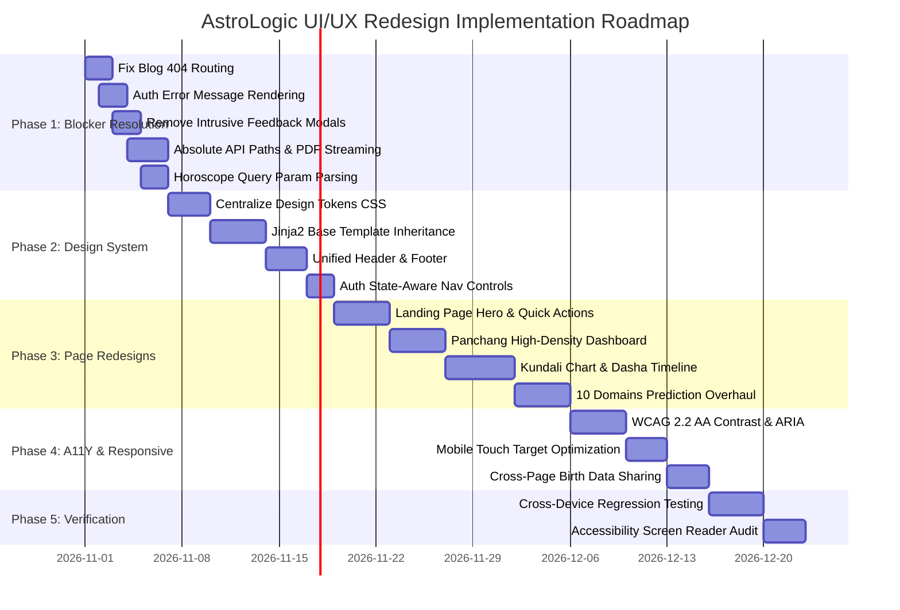

# UI/UX Redesign & Implementation Roadmap

**Product:** AstroLogic / Nakshatra Labs  
**Version:** 2.0.0  
**Scope:** Phased, actionable engineering and design implementation roadmap to transition the platform from its fragmented multi-page state into an enterprise-grade, cohesive Vedic astrology product.

---

## Roadmap Overview

---

## Phase 1: Critical Usability & Functional UX Blockers (Sprint 1)

### Objective
Eliminate all P0 and P1 blocking defects that cause broken links, silent authentication failures, 404 network errors, or coercive modal interruptions.

### Key Work Items
1. **Fix Blog Article Routing (ISSUE-01):**
   - *Affected Files:* `astro-platform/app/templates/blogs.html` (lines 328, 341, 356) and `app/api/routes/pages.py`.
   - *Action:* Change all anchor tags from `/blogs/${b.id}` to `/blog/${b.id}`. Add a 301 permanent redirect in `pages.py` mapping `/blogs/{blog_id}` to `/blog/{blog_id}` for backwards compatibility.
2. **Implement Visible Auth Error Feedback (ISSUE-02):**
   - *Affected Files:* `astro-platform/app/templates/auth.html` (line 341).
   - *Action:* Add `
{{ error }}
`.
3. **De-escalate Testing Feedback Modals (ISSUE-03, ISSUE-11):**
   - *Affected Files:* `astro-platform/app/templates/prediction.html` (lines 479–484) and `kundali.html` (lines 899–908).
   - *Action:* Remove the automated modal popup from the calculation and download handlers. Replace with an unobtrusive inline feedback card at the bottom of the page.
4. **Normalize API Endpoints to Absolute Paths (ISSUE-04):**
   - *Affected Files:* `astro-platform/app/templates/kundali.html` (lines 468, 767).
   - *Action:* Replace relative `api/kundali` and `api/cities` with absolute `/api/kundali` and `/api/cities`. Remove the hardcoded `astrologic-vedic-1.onrender.com` remote URL.
5. **Connect Horoscope URL Query Parameters (ISSUE-06, ISSUE-07):**
   - *Affected Files:* `astro-platform/app/templates/daily-horoscope.html` (lines 427–432, 495).
   - *Action:* Parse `new URLSearchParams(window.location.search).get('sign')` on load and replace internal developer error messages with a friendly customer alert.
6. **Fix Profile Form Redirection (ISSUE-10):**
   - *Affected Files:* `astro-platform/app/api/routes/auth.py` (line 200).
   - *Action:* Redirect to `/profile?updated=true` and display an inline green confirmation alert.

- **Dependencies:** None. Can be implemented immediately.
- **Expected Outcome:** Zero broken links, visible authentication errors, unhindered prediction reading, and reliable Kundali generation across all URL variations.
- **Risks:** Minimal. No schema changes required.
- **Completion Criteria:** Automated crawl of all site links returns 0 HTTP 404s; invalid credentials produce visible red alert.

---

## Phase 2: Shared Layout & Design-System Standardization (Sprint 2)

### Objective
Eliminate CSS duplication and layout shift across the 16 templates by creating a master Jinja2 layout and a centralized design token stylesheet.

### Key Work Items
1. **Centralize Design Tokens:**
   - *New File:* `astro-platform/app/static/css/tokens.css`.
   - *Action:* Extract all CSS variables (`--gold`, `--gold2`, `--gold-dim`, `--blue`, `--green`, `--red`, `--surface`, `--border`, `--text`, `--text-dim`) into a single file. Increase `--text-dim` opacity to `rgba(232,232,232, 0.72)` for WCAG AA compliance.
2. **Master Layout Template (`base.html`):**
   - *Affected File:* `astro-platform/app/templates/base.html`.
   - *Action:* Transform `base.html` from a 15-line language snippet into a complete master shell containing:
     - Standardized `<head>` with preloaded Google Fonts.
     - Sticky 68px header with dynamically determined authentication controls (`Sign In` vs `Profile / Logout`).
     - Global mobile drawer with unified links (no `.html` extensions).
     - Standard 4-column footer (removing public links to `/admin/blogs`).
     - Content block ``.
3. **Refactor All 16 Templates to Extend `base.html`:**
   - *Affected Files:* `index.html`, `panchang.html`, `kundali.html`, `daily-horoscope.html`, `prediction.html`, `blogs.html`, `blog-detail.html`, `about.html`, `profile.html`.
   - *Action:* Strip duplicate `<header>`, `<nav>`, `.mob-nav`, `<footer>`, and body background star pseudo-elements from all individual templates.

- **Dependencies:** Completion of Phase 1.
- **Expected Outcome:** Elimination of ~2,500 lines of duplicated markup and CSS; zero layout shift when navigating across pages; single point of maintenance for navigation and footers.
- **Risks:** Potential CSS specificity collisions when merging per-page styles into a shared layout.
- **Completion Criteria:** Modifying a link in `base.html` instantly updates the header across all 16 pages; header height is exactly 68px everywhere.

---

## Phase 3: Page-Specific Core Feature Redesigns (Sprint 3)

### Objective
Redesign the core astrology workflows for enhanced usability, reduced cognitive load, and premium visual elegance.

### Key Work Items
1. **Homepage Hero Redesign:**
   - Restore or clean up the interactive constellation graphic in the hero.
   - Replace cluttered quick-grid buttons with a single unified 3-step action card: "Enter Birth Details → View Cosmic Chart → Explore 10 Domains".
2. **Panchang Dashboard Progressive Disclosure:**
   - Restructure the dense 25+ parameter layout into 3 distinct sections:
     - *Hero Card:* Live Cosmic Day Score + Current Choghadiya Countdown + Active Planetary Hora.
     - *Tab 1:* 5 Sacred Limbs (Tithi, Nakshatra, Yoga, Karana, Vara) with visual progress bars.
     - *Tab 2:* Auspicious & Inauspicious Muhurats (Abhijit, Brahma, Rahu Kaal, Disha Shool).
     - *Tab 3:* Personalized Tara Bala & Chandra Bala.
   - Redesign mobile Choghadiya timeline into a fluid touch-friendly carousel.
3. **Kundali Interactive Visualizer Upgrade:**
   - Add South Indian (box grid) and East Indian chart options alongside the existing North Indian diamond chart.
   - Make planet nodes on the chart clickable to highlight corresponding rows in the Navagraha table.
   - Stream high-resolution PDF directly from `GET /api/download-kundali`.
4. **10 Life Domains UX Overhaul:**
   - Create a horizontal sticky domain navigation pill bar on mobile.
   - Introduce visual confidence meters (High, Moderate, Speculative) for each domain timing window.
   - Group remedies into clean actionable tabs: Gemstones, Mantras, Dietary/Fasts, and Vedic Rituals.

- **Dependencies:** Completion of Phase 2 (Design System & Base Layout).
- **Expected Outcome:** State-of-the-art interactive astrology experience rivaling top enterprise competitors (e.g., AstroSeek, Co-Star, DrikPanchang).
- **Risks:** SVG mathematical re-calculation overhead.
- **Completion Criteria:** User can switch between North and South Indian chart styles smoothly; Panchang mobile layout displays zero truncated text.

---

## Phase 4: Cross-Module Persistence & Accessibility (Sprint 4)

### Objective
Implement frictionless data continuity between tools and ensure full WCAG 2.2 AA accessibility compliance.

### Key Work Items
1. **Cross-Page Birth Data Persistence:**
   - *Implementation:* Store the active birth chart payload in `sessionStorage` (`astrologic_active_chart`).
   - *Outcome:* When a user calculates their chart on `/kundali`, navigating to `/prediction` or `/panchang` immediately pre-fills their birth date, time, and city.
2. **Accessibility Remediation (WCAG 2.2 AA):**
   - Add `role="tab"` and `role="tablist"` with keyboard arrow navigation to domain tabs on `/prediction` and Choghadiya tabs on `/panchang`.
   - Add `<title>` and `<desc>` tags to North Indian SVG charts.
   - Ensure all form inputs have associated `<label>` tags with matching `for`/`id` pairs.
   - Add accessible labels (`aria-label="4.5 out of 5 stars"`) to daily horoscope rating stars.
3. **Touch Target Size Optimization:**
   - Ensure all interactive buttons, pills, and navigation links have a minimum touch target size of 44 × 44 CSS pixels per WCAG 2.5.5.

- **Dependencies:** Completion of Phase 3.
- **Expected Outcome:** Seamless user journey from landing page through Kundali and Predictions without re-entering data; 100% WCAG 2.2 AA compliance score on Lighthouse/Axe.
- **Risks:** Session storage synchronization edge cases.
- **Completion Criteria:** Lighthouse Accessibility score >= 95 on all public pages.

---

## Phase 5: Final Regression Testing & Verification (Sprint 5)

### Objective
Comprehensive visual and functional regression verification across physical devices, browsers, and network speeds.

### Key Work Items
1. **Viewport & Device Verification:**
   - Mobile: 375 × 812 (iPhone SE / mini), 390 × 844 (iPhone 14/15/16).
   - Tablet: 768 × 1024 (iPad Mini / Air portrait).
   - Laptop: 1366 × 768 (Standard corporate laptop).
   - Desktop: 1920 × 1080 (Full HD).
2. **Screen Reader Testing:**
   - Test full user journey using NVDA on Windows and VoiceOver on iOS. Verify chart announcements, form error states, and modal focus trapping.
3. **Network Performance Optimization:**
   - Implement font subsetting for `Cinzel` and `Crimson Pro`.
   - Ensure Core Web Vitals targets: Largest Contentful Paint (LCP) < 2.0s, Cumulative Layout Shift (CLS) < 0.05.

- **Dependencies:** Completion of Phases 1–4.
- **Expected Outcome:** Certified enterprise-ready, accessible, visually stunning Vedic astrology web platform.
- **Completion Criteria:** Zero P0/P1 defects remaining; all 29 routes verified functional; zero console errors on major modern browsers (Chrome, Safari, Firefox, Edge).
