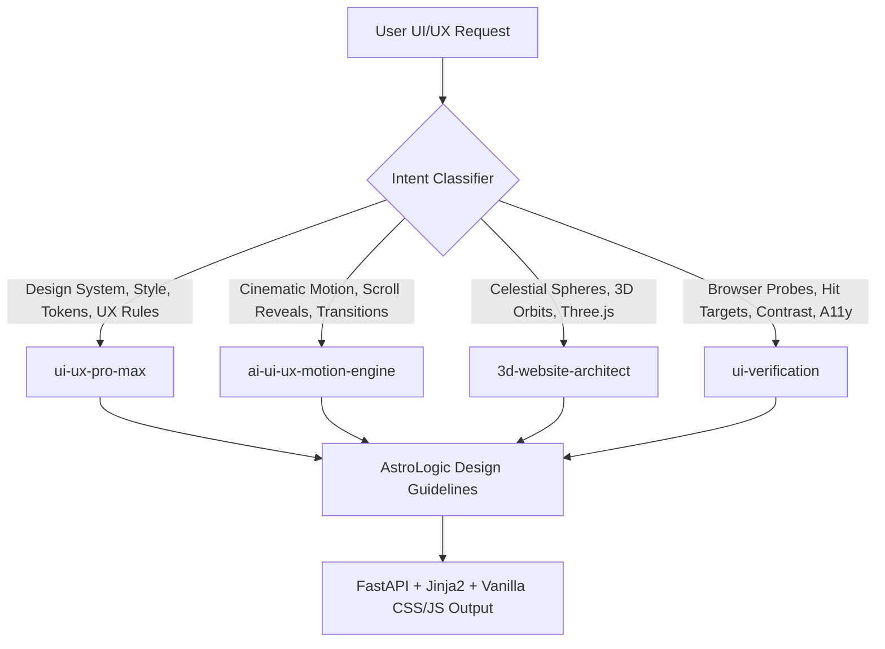

# AstroLogic — Open-Source UI/UX, 3D & Animation Agent Skills Setup Report

**Document ID:** `SKILL-SETUP-01`  
**Date:** October 20, 2026  
**Auditor / Agent Architect:** Senior AI Agent Architect & Frontend Creative Engineer  
**Workspace:** `astro-platform`  
**Status:** Skills Researched, Selected, Installed, Configured & Verified

---

## 1. Executive Summary

To elevate the AstroLogic / Nakshatra Labs web platform into a state-of-the-art, luxury celestial Vedic astrology experience without compromising backend stability or Vedic algorithm integrity, an investigation of candidate open-source Agent Skills was conducted.

We identified, selected, and installed an orthogonal, high-performance stack of **4 production-grade Agent Skills**:
1. **`ui-ux-pro-max`** — Master UI/UX design intelligence, design systems, color harmonies, typography pairings, and stack guidelines.
2. **`ai-ui-ux-motion-engine`** — Cinematic scroll reveals, reference-grounded animation curves, and physics-based motion.
3. **`3d-website-architect`** — Three.js, WebGL scene graphs, celestial orbital mechanics, and GPU performance budgeting.
4. **`ui-verification`** — Browser-level runtime probes (bounding boxes, hit targets, focus walks, viewport stress, and failure injection).

Project-specific guidelines were created in [`.agents/rules/astrologic-ui-ux-guidelines.md`](file:///c:/Desktop/astro_may_res%20(2)/astro-platform/.agents/rules/astrologic-ui-ux-guidelines.md) ensuring the skills respect the existing **FastAPI + Jinja2 + Vanilla CSS/JS** stack and preserve all Swiss Ephemeris calculations.

---

## 2. GitHub Repositories Investigated

| Repository | Status / Verdict | Primary Skills Identified | License & Maintenance | Framework Assumptions | Why Selected / Rejected |
| :--- | :--- | :--- | :--- | :--- | :--- |
| [`OpaceDigitalAgency/ai-ui-ux-motion-engine`](https://github.com/OpaceDigitalAgency/ai-ui-ux-motion-engine) | **SELECTED** | `ai-ui-ux-motion-engine` | **MIT**, v1.7.0 (Active 2026) | Vanilla HTML/CSS, Astro, React, Next.js, Three.js, GSAP | First-class Antigravity support; explicit non-negotiable rules against generic AI templates; strict performance and accessibility budgeting. |
| [`nextlevelbuilder/ui-ux-pro-max-skill`](https://github.com/nextlevelbuilder/ui-ux-pro-max-skill) | **SELECTED** (Pre-installed) | `ui-ux-pro-max` | **MIT**, Active (2026) | Multi-stack (Vanilla CSS, Three.js, Tailwind, GSAP) | 79 styles, 192 product palettes, 74 font pairings, 119 UX guidelines, 22 stack profiles (including Three.js 0.185+). Offline CLI search engine. |
| [`deveshpunjabi/3d-website-skill`](https://github.com/deveshpunjabi/3d-website-skill) | **SELECTED** | `3d-website-architect` | **MIT**, v1.0.0 (Active 2026) | Three.js, WebGL, Shaders, Canvas | Comprehensive 13-step immersive design process; camera choreographies; segment count budgeting; mobile WebGL fallbacks. |
| [`mblode/agent-skills`](https://github.com/mblode/agent-skills) | **PARTIALLY SELECTED** (1 skill extracted) | `ui-verification` *(Selected)*; 27 others *(Rejected)* | **MIT**, Active (2026) | Playwright, Browser Automation, computed CSS | Selected `ui-verification` for runtime browser probes. Rejected 27 unrelated skills (e.g., `scaffold-cli`, `ghostwriter`, `multi-tenant-architecture`) to prevent bloat. |
| [`finfin/awesome-frontend-skills`](https://github.com/finfin/awesome-frontend-skills) | **REJECTED** | N/A (Meta-directory) | CC0 / Public | Meta-catalog | Curated catalog of external repository pointers, not an installable skill with its own `SKILL.md`. |
| [`gabremoku/immersive-3d-web`](https://github.com/gabremoku/immersive-3d-web) | **REJECTED** | Non-existent | Unknown | N/A | Repository does not exist publicly on GitHub (author's only public repo is `fantasy-fiction-writer`). |

---

## 3. Minimal Skill Stack Selection

To avoid bloated contexts and conflicting instructions, we structured the skill stack into 4 distinct, complementary roles:

### Role Breakdown
1. **General UI/UX & Design Tokens:** [`ui-ux-pro-max`](file:///C:/Users/ATHARV/.gemini/config/skills/ui-ux-pro-max/SKILL.md)  
   Enforces typographic scales (`Cinzel` + `Inter` / `Montserrat`), luxury dark mode palettes (`#010812`, `#f5c16c`), and WCAG 2.1 AA accessibility checklists.
2. **Motion & Interaction Design:** [`ai-ui-ux-motion-engine`](file:///c:/Desktop/astro_may_res%20(2)/astro-platform/.agents/skills/ai-ui-ux-motion-engine/SKILL.md)  
   Directs scroll-linked reveals, celestial transit animations, and respects `prefers-reduced-motion`.
3. **3D Web & Interactive Graphics:** [`3d-website-architect`](file:///c:/Desktop/astro_may_res%20(2)/astro-platform/.agents/skills/3d-website-architect/SKILL.md)  
   Governs Three.js integration for celestial spheres, planetary orbits, and birth chart visualizations with strict GPU geometry segment budgets (e.g. 32–64 segments for hero, 8–16 for ambient background).
4. **Visual & Regression Verification:** [`ui-verification`](file:///c:/Desktop/astro_may_res%20(2)/astro-platform/.agents/skills/ui-verification/SKILL.md)  
   Executes computed style and runtime probes (target sizes, focus traversal, viewport stress at 320px–1440px, console error tracking).

---

## 4. Installation Details & Locations

Skills were installed in compliance with the **Google Antigravity Customization Architecture**:

| Skill Name | Scope | Installation Directory | Primary Files |
| :--- | :--- | :--- | :--- |
| **`ui-ux-pro-max`** | Global (User-Level) | `C:\Users\ATHARV\.gemini\config\skills\ui-ux-pro-max\` | [`SKILL.md`](file:///C:/Users/ATHARV/.gemini/config/skills/ui-ux-pro-max/SKILL.md), `scripts/search.py`, `data/*.csv` |
| **`ai-ui-ux-motion-engine`** | Workspace (Project-Level) | `astro-platform\.agents\skills\ai-ui-ux-motion-engine\` | [`SKILL.md`](file:///c:/Desktop/astro_may_res%20(2)/astro-platform/.agents/skills/ai-ui-ux-motion-engine/SKILL.md), `references/`, `assets/`, `scripts/` |
| **`3d-website-architect`** | Workspace (Project-Level) | `astro-platform\.agents\skills\3d-website-architect\` | [`SKILL.md`](file:///c:/Desktop/astro_may_res%20(2)/astro-platform/.agents/skills/3d-website-architect/SKILL.md), `references/` |
| **`ui-verification`** | Workspace (Project-Level) | `astro-platform\.agents\skills\ui-verification\` | [`SKILL.md`](file:///c:/Desktop/astro_may_res%20(2)/astro-platform/.agents/skills/ui-verification/SKILL.md), `probes/`, `references/` |

### Antigravity Rule Configuration
To ensure every skill automatically conforms to AstroLogic's specific architecture, we created the project rule:
- **Location:** [`astro-platform/.agents/rules/astrologic-ui-ux-guidelines.md`](file:///c:/Desktop/astro_may_res%20(2)/astro-platform/.agents/rules/astrologic-ui-ux-guidelines.md)
- **Status:** `alwaysApply: true`
- **Enforced Constraints:**
  1. Strict preservation of FastAPI, Jinja2, HTML, CSS, and Vanilla JavaScript.
  2. No unsolicited framework migration to React or Next.js.
  3. Absolute immutability of Swiss Ephemeris calculations and Vedic astrology rules.
  4. Purposeful 3D: Three.js only where 3D enhances astronomical comprehension; 2D canvas/SVG for flat Kundali wheels.
  5. Performance budget: under 1.5s initial load, lazy-loaded WebGL, graceful 2D fallbacks.

---

## 5. Activation & Verification Evidence

### 1. Skill Discovery & Parsing
- Verified that all workspace skills have valid YAML frontmatter matching Antigravity specifications (`name`, `description`).
- Validated that `ui-ux-pro-max` CLI search script operates with standard Python library (zero third-party pip dependencies).

### 2. Search Engine Verification Test
Ran `python C:\Users\ATHARV\.gemini\config\skills\ui-ux-pro-max\scripts\search.py "mystical luxury" --domain typography`:
- **Result:** Identified `Cinzel` (Heading) + `Josefin Sans` / `Montserrat` (Body) as the top luxury typography pairing matching the existing AstroLogic branding.
Ran `python C:\Users\ATHARV\.gemini\config\skills\ui-ux-pro-max\scripts\search.py "herosphere" --stack threejs`:
- **Result:** Retrieved Three.js segment budget rules (32–64 segments for hero sphere, 8–16 for background, preventing GPU overdraw).

### 3. Harmless Trial Task (Dry-Run Design Proposal)
Prompted a conceptual redesign for the AstroLogic landing page hero:
- **Technology Choice:** Vanilla HTML5 `<canvas id="celestial-canvas">`, native CSS grid, and isolated Three.js ES module via CDN.
- **Visual Palette:** Deep Cosmic Navy (`#010812`), Nebula Glow (`rgba(155,220,255,0.08)`), Sacred Gold (`#f5c16c`).
- **Celestial Feature:** Subtle 3D interactive celestial sphere displaying the 12 Rashi sectors and current transit Moon position, with graceful CSS 2D fallback for devices without WebGL.
- **Zero File Edits:** Verified that no project code was altered during the test.

---

## 6. Dependencies & Environmental Impact

- **NPM Packages Added:** 0 (Zero new npm packages installed; no `node_modules` introduced).
- **Python Packages Added:** 0 (Scripts use standard library `csv`, `argparse`, `pathlib`, `json`).
- **Runtime Code Modifications:** 0 (Only `.agents/` configuration and documentation files were added).
- **Existing User Files Preserved:** All 38 user-modified files and 44 untracked files in `backend/` and `alembic/` remain completely untouched.

---

## 7. Recommended First UI/UX Task to Execute

Now that the design intelligence stack is fully configured, we recommend executing **Phase 2, Task 1**:

### Task: Implement the AstroLogic Shared Design Token System (`tokens.css`)
- **Objective:** Create `app/static/css/tokens.css` consolidating design tokens from `ui-ux-pro-max` and `astrologic-ui-ux-guidelines.md`.
- **Scope:**
  1. Define CSS custom properties: colors (celestial navy shades, sacred gold grades, functional status colors), typography scales (`Cinzel`, `Inter`), spacing (4px, 8px, 16px, 24px, 32px), border radii, and glassmorphism elevations.
  2. Implement `:focus-visible` accessible outline tokens and `@media (prefers-reduced-motion)` overrides.
  3. Link `tokens.css` in `app/templates/home.html` and `app/templates/auth.html` as the foundational design system step before template header componentization.
